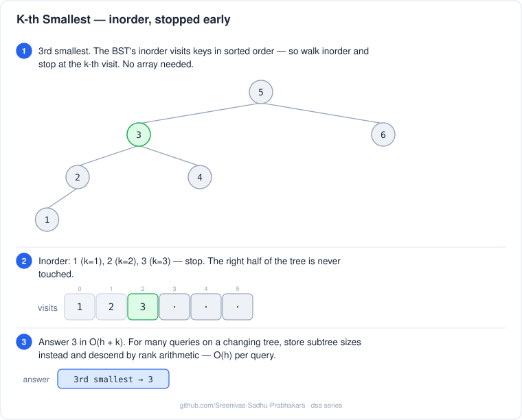

# K-th Smallest in a BST

> Striver SDE Sheet 140 · Day 21 BST II — inorder visits a BST in sorted order, so stop the iterative traversal at the k-th visit. Go, stdlib only, tested.

## Problem

Return the k-th smallest value in a BST without flattening the whole tree into a sorted array first.

## Approach

Inorder traversal of a BST *is* ascending order — so the k-th smallest is simply the k-th node an inorder walk visits. Using the explicit-stack iterative form (from #104) matters here: it can **stop** the moment the counter hits zero, having touched only the k smallest nodes plus the left spine — recursion would need an awkward early-exit signal. Visited work is O(h + k), not O(n). The follow-up interviewers like: for *repeated* queries, augment each node with its subtree size and the walk becomes a O(h) rank descent — same idea as order-statistic trees.

**Complexity:** O(h + k) time, O(h) stack.

## Visual walkthrough

Read the picture top to bottom — each numbered frame is one moment of the algorithm
running on this repo's test example.

## Run

    go test ./...   # verify
    go run .        # demo

---

One of 191 repos solving Striver's SDE Sheet in Go — stdlib only, one problem per repo, every solution tested. Browse the set: [`dsa-*` repos](https://github.com/Sreenivas-Sadhu-Prabhakara?tab=repositories&q=dsa-&type=source).
